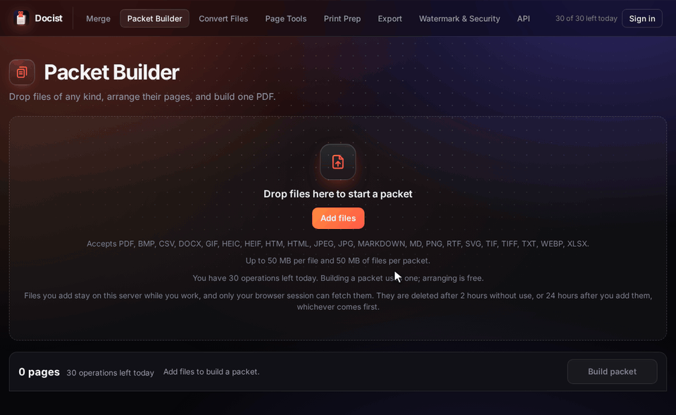
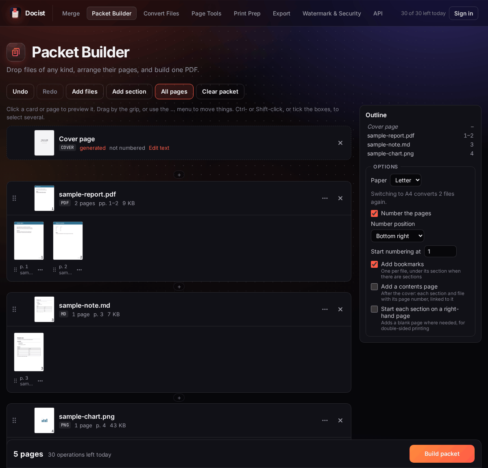
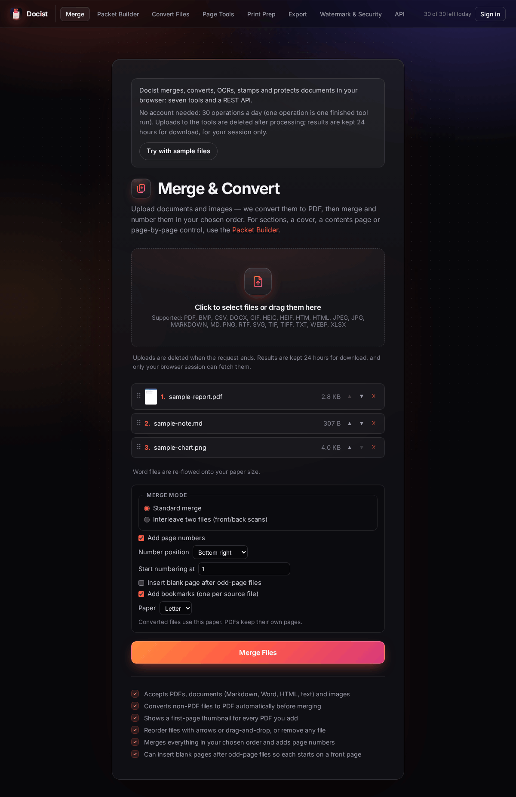
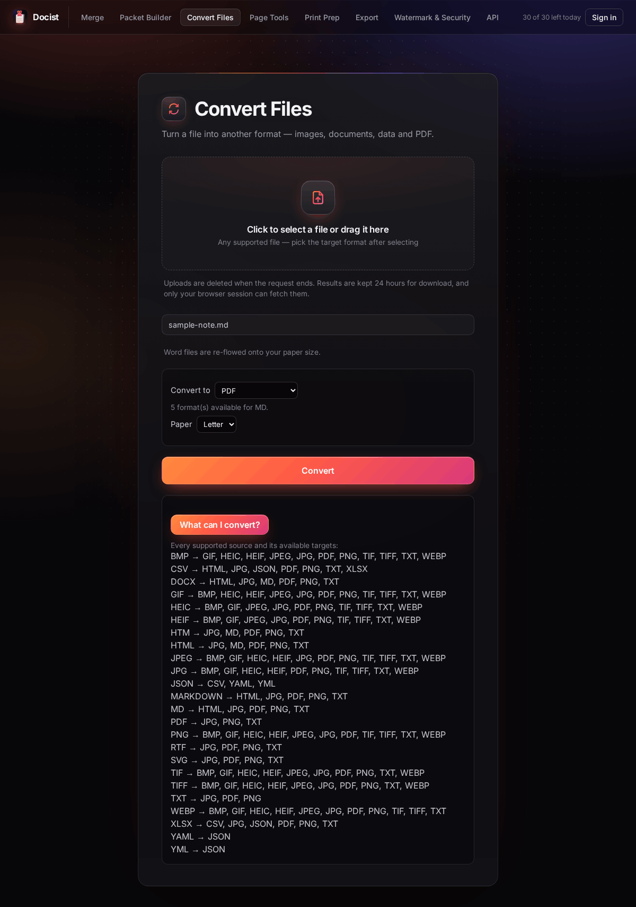
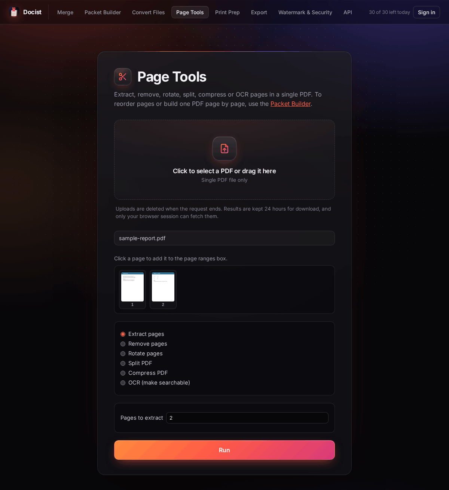
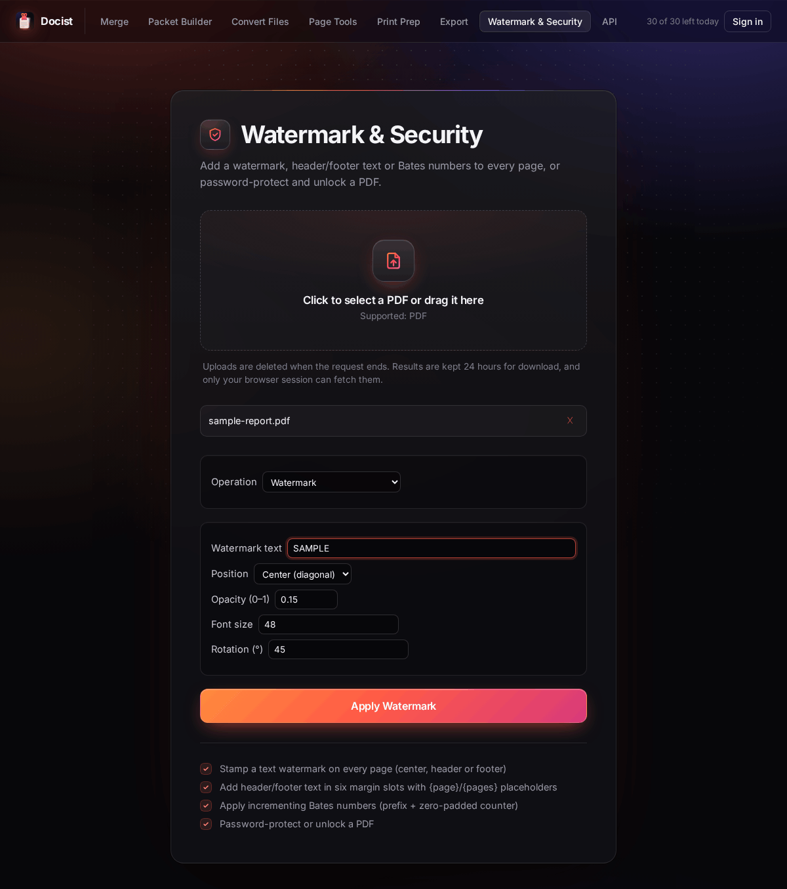
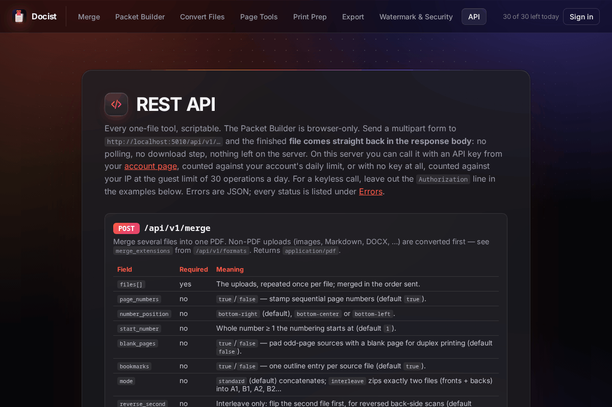

# Docist

[](https://github.com/CodeManEthan/docist/actions/workflows/tests.yml)

A self-hosted document toolkit. Build one PDF packet from files of any kind in the Packet Builder, merge 16 file types into one PDF, convert files across 102 format pairs, edit and split pages, impose booklets, export to images or text with OCR, and stamp, watermark and password-protect documents. Seven browser tools and a REST API, open to anonymous visitors within a daily limit, with email accounts for more.



Live demo: [docist-production.up.railway.app](https://docist-production.up.railway.app). No account needed: guests get 30 operations a day. Accounts sign up with an emailed verification link. The API works with a key from `/account`, or keyless at the guest limit.

## Highlights

- **Seven tool pages plus a REST API.** Packet Builder, Merge & Convert, Convert Files, Page Tools, Print Prep, Export, Watermark & Security, and a versioned `/api/v1` with docs served at `/api`.
- **Plugin architecture.** Converters (`anything → PDF`) and transforms (`anything → anything`) are modules the app finds at startup, with no registry file to edit. When no direct transform exists, the registry pivots through PDF, so `DOCX → PNG` works without anyone writing it.
- **Page thumbnails throughout.** The Packet Builder can show every page of every file, every PDF added to the merge list shows its first page, and Page Tools renders a clickable grid of the whole document that fills the page-range box for you.
- **More than 1,700 backend tests and 300 frontend tests.** pytest and `node:test`, run in CI on Python 3.11 and 3.12, covering every converter, transform, PDF operation, route and hardening rule.
- **Accounts and daily limits.** Anonymous use with a per-IP daily allowance, email and password accounts with a larger one, per-user API keys, and results only their owner can download.
- **Hardened for deployment.** CSRF protection, per-IP rate limiting, magic-byte content sniffing on every upload, traversal-proof downloads, each tool's work in its own capped child process, and AES-256 PDF encryption.

## Quick start

Needs Python 3.11+ on Linux (macOS should work; untested).

```bash
git clone https://github.com/CodeManEthan/docist.git
cd docist
python3 -m venv .venv
.venv/bin/pip install -r requirements.txt
./run.sh
```

Then open http://localhost:5010. `./run.sh prod` runs gunicorn (`--preload`, 2 workers) on `127.0.0.1:5010` instead of the dev server, and `DOCIST_PORT=8080 ./run.sh` picks another port.

Or with Docker (the image listens on 5010 and includes Tesseract, its 14 OCR languages and LibreOffice):

```bash
docker build -t docist .
docker run -p 5010:5010 docist
```

Accounts live in SQLite under `instance/` unless `DATABASE_URL` points at Postgres. Emails are logged to the terminal until a sender is configured. OCR needs system packages (see [Requirements](#requirements)); without them the app runs and the OCR options are greyed out. See `DEPLOYMENT.md` for the production settings (`DOCIST_SECRET_KEY`, `DOCIST_COOKIE_SECURE`, `DOCIST_TRUSTED_PROXIES`, the email backends).

## Features

### Packet Builder (`/packet`)



Drop in files of any kind Docist can read (PDFs, Word, Markdown, images, spreadsheets and the rest of the merge formats) and arrange them into one PDF. No account needed; a build costs one operation.

- **Pages, not just files.** Each file becomes a card; **All pages** expands every file into its pages, so you can drag one page out of a file and put it anywhere in the packet.
- **Drag, keyboard or touch.** Drag cards and pages by the grip, or pick one up with Space or Enter on its grip and move it with the arrow keys. The `…` menu moves things too. Select several with Ctrl or Shift, or with a long press on a phone.
- **Sections, cover and dividers.** Group files into sections, add a cover page with a title and subtitle, and open a section with a divider page that carries its title.
- **Linked contents page.** An optional contents page after the cover lists each section and file with its page number, each line a link to that page.
- **Page numbers and bookmarks.** Number the pages (position and starting number), add one bookmark per file under its section, and start each section on a right-hand page for double-sided printing.
- **Undo and drafts.** Undo and redo every change (Ctrl+Z, Ctrl+Shift+Z). The packet is saved as a draft in the browser as you work, and a reload offers to restore it.
- **Short-lived staging.** Added files stay on the server only while you work and only your browser session can fetch them; they are deleted after two hours without use or 24 hours after you add them (both configurable).

### Merge & Convert (`/`)



- **Multiple File Upload**: Select and upload multiple files at once
- **Page thumbnails**: Every PDF row shows a rendered first-page thumbnail, so you can tell two similarly-named scans apart before merging
- **Format Conversion**: Non-PDF files are automatically converted to PDF before merging:
  - Markdown (`.md`, `.markdown`) — headings, tables, code blocks, lists
  - Word documents (`.docx`)
  - HTML (`.html`, `.htm`)
  - Plain text (`.txt`) — monospace, line-wrapped, multi-page
  - Rich text (`.rtf`) — plain-text extraction
  - Spreadsheets (`.csv`, `.xlsx`) — rendered as tables, one per sheet, landscape for wide sheets
  - Images (`.png`, `.jpg`, `.jpeg`, `.gif`, `.bmp`, `.webp`, `.tiff`, `.tif`, `.heic`, `.heif`) — centered on the chosen paper, multi-frame TIFF/GIF becomes multiple pages
  - Vector graphics (`.svg`) — scaled to fit the page
- **Paper**: Letter (default) or A4 for every converted file; the browser remembers the choice. PDFs keep their own pages, and HTML that sets its own `@page` size keeps it
- **Reorder & Remove**: Drag rows (or use ▲/▼ buttons) to reorder files before merging; remove files with ✕
- **Merge Options**: Toggle page numbers (position: bottom left/center/right, custom start number), toggle blank-page insertion, toggle bookmarks, paper size
- **Bookmarks**: The merged PDF gets one outline entry per source file
- **Front Page Alignment**: Optionally insert blank pages after odd-page documents so every file starts on a front page (perfect for duplex printing; off by default)
- **Interleave Mode**: Combine two separately-scanned stacks (fronts + backs) by alternating pages, with reverse-order handling for flatbed/ADF back-side scans

### Convert Files (`/convert`)

File-to-file conversion: upload a file and pick a target format. The page lists every source format and its targets under "What can I convert?".



- **Images ↔ images**: PNG, JPG, WebP, BMP, TIFF, GIF, HEIC/HEIF — every direction (alpha flattened for JPEG/BMP, adaptive palette for GIF)
- **Documents**: Markdown ↔ HTML, HTML → Markdown/text, DOCX → HTML/Markdown/text, RTF → text, Markdown → text
- **Data**: CSV ↔ XLSX, CSV/XLSX → JSON, JSON → CSV, JSON ↔ YAML, CSV → HTML table
- **PDF bridge**: any supported format → PDF; PDF → PNG/JPG (zip when multi-page) or text
- **Image → text (OCR)**: any raster image → `.txt` via Tesseract, in one or two of the installed languages
- **Pivot routing**: when no direct path exists, conversions chain automatically through PDF (e.g. Markdown → PNG, SVG → JPG)

### Page Tools (`/pages`)



- **Page thumbnail grid** — the whole document is rendered as a grid; clicking a page appends its number to the range box for the current operation
- **Extract / Remove pages** by range spec (e.g. `1-3,5,8-10`)
- **Rotate pages** (90°/180°/270°, all pages or a range)
- **Split PDF** — every N pages, or by ranges (`;`-separated), delivered as a zip
- **Compress** — lossless content-stream compression plus image downsampling/re-encoding (quality and DPI caps); output never larger than input
- **OCR (make searchable)** — adds an invisible text layer to scanned PDFs via OCRmyPDF/Tesseract; choice of up to two installed languages (14 in the Docker image), optional deskew, force re-OCR; pages that already have text pass through untouched

### Print Prep (`/print`)
- **N-up** — 2 or 4 pages per sheet on Letter or A4, aspect-preserving, centered
- **Booklet** — saddle-stitch imposition: print duplex (flip on short edge), fold in half, read in order

### Export (`/export`)
- **PDF → images** — PNG or JPG per page at 30–600 DPI, zipped
- **PDF → text** — UTF-8 text with page separators, with optional OCR fallback for scanned pages (only pages without a text layer are OCR'd)

### Watermark & Security (`/security`)



- **Text watermark** — center (diagonal), header, or footer; opacity, font size, rotation, color
- **Header / Footer** — six slots (left/center/right × top/bottom) with `{page}` and `{pages}` placeholders
- **Bates numbering** — prefix + zero-padded counter (e.g. ACME000001), four corner positions
- **Protect** — password-encrypt a PDF with **AES-256** (`/V 5 /R 6`, via pypdf + `cryptography`)
- **Unlock** — remove password protection (requires the current password); accepts legacy RC4-40/RC4-128/AES-128 files created elsewhere as well as Docist's own AES-256 output

## REST API

Every one-file tool, scriptable. The Packet Builder is browser-only. Send a multipart form to `/api/v1/…` and the finished **file comes back in the response body**: no polling, no download step, and nothing is written to `output/`. Errors are JSON `{"error": "…"}`; `/api` lists every status the API answers (400, 401, 413, 429, 500) and what each one means.

| Method | Endpoint | Returns |
|---|---|---|
| `POST` | `/api/v1/merge` | Several files (PDF or convertible) merged into one PDF |
| `POST` | `/api/v1/convert` | One file converted to `target` (e.g. `.png`); a multi-page `pdf → png` comes back as a `.zip` |
| `POST` | `/api/v1/pages/extract` | A new PDF with only the pages named in `ranges` |
| `POST` | `/api/v1/pages/split` | The parts (`mode` `every_n` or `ranges`, with `value`), as one zip |
| `POST` | `/api/v1/pages/rotate` | Pages turned clockwise by `angle` (90, 180 or 270), all of them or `ranges` |
| `POST` | `/api/v1/pages/remove` | The PDF without the pages named in `ranges` |
| `POST` | `/api/v1/pages/compress` | Images recompressed (`image_quality`, `image_max_dpi`) |
| `POST` | `/api/v1/pages/ocr` | A searchable text layer added (`language`, `deskew`, `force`) |
| `POST` | `/api/v1/print/nup` | 2 or 4 pages per sheet (`n`, `paper`) |
| `POST` | `/api/v1/print/booklet` | A saddle-stitch booklet (`paper`) |
| `POST` | `/api/v1/watermark` | The PDF with `text` stamped across every page |
| `POST` | `/api/v1/stamp/header-footer` | Text in six margin slots, with `{page}` and `{pages}` filled in |
| `POST` | `/api/v1/stamp/bates` | Bates numbers (`prefix`, `start`, `digits`, `position`) |
| `POST` | `/api/v1/export` | The pages as a zip of images (`operation=images`) or the text (`operation=text`) |
| `POST` | `/api/v1/protect` | The PDF encrypted with a password (AES-256) |
| `POST` | `/api/v1/unlock` | The PDF with a known password removed |
| `GET` | `/api/v1/formats` | Discovery JSON: operations, merge inputs, the conversion matrix, paper sizes, OCR languages |

```bash
curl -X POST http://localhost:5010/api/v1/merge \
  -H "Authorization: Bearer $DOCIST_API_KEY" \
  -F "files[]=@chapter1.pdf" \
  -F "files[]=@notes.md" \
  -F "page_numbers=true" \
  -F "number_position=bottom-center" \
  -o merged.pdf
```

Call it with an API key from `/account`, sent as a bearer token. Sign up, verify your email, and create a key there; it is shown once and stored only as a hash. Where the server sets `DOCIST_API_ANONYMOUS=1` (off by default; on in the live demo), you can also leave out the `Authorization` line and call it keyless at the guest limit, counted against your IP. With keyless calls off, a missing key gives `401 {"error": "API key required. Create one at /account."}`. A wrong or revoked key always gives `401 {"error": "Invalid or revoked API key."}`. The browser session cookie is ignored on `/api/v1`. Each successful call costs one operation from the caller's daily allowance, reported in the `X-Docist-Usage-Limit` and `X-Docist-Usage-Remaining` headers; past it you get `429` with `code: "daily_limit"` and a `Retry-After`. `GET /api/v1/formats` needs no key. **`/api` serves the full documentation**, with every field, default and `curl` example, built from the server's own address:



## Security & Deployment

Docist ships hardened for small self-hosted deployments (see `DEPLOYMENT.md` for the full recipe — gunicorn, nginx, systemd):

- **Anonymous use, daily limits** — every tool works without an account, up to `DOCIST_LIMIT_ANON` operations a day per IP (default 10). A verified free account gets `DOCIST_LIMIT_FREE` (default 50); any paid plan is unlimited by default. One operation is one successful tool POST or API call; the count resets at midnight UTC and the nav shows what is left.
- **Accounts** — email and password (scrypt hashes), email verification and password reset through a pluggable sender (`console`, SMTP or Resend), 30-day signed sessions (`HttpOnly`/`SameSite=Lax`, `Secure` behind HTTPS), "sign out everywhere", and throttled login/signup/reset forms. Unverified accounts stay on guest limits. Plans are set with `flask --app app set-plan EMAIL PLAN`; there is no billing yet.
- **CSRF protection** — every browser POST carries a per-session token; `/api/v1` ignores the cookie and takes an API key instead.
- **Safe, owner-bound downloads** — the shared `/download` endpoint refuses path traversal, serves only plain filenames inside `output/`, and answers 404 unless the result was made by the same browser session or signed-in user.
- **Upload validation** — file content is sniffed (magic bytes) against the claimed extension before any converter runs.
- **Isolated, self-cleaning storage** — every request works in its own temp directory; results get unguessable names (an owner tag plus a random key only the requester receives) and are pruned from `output/` after 24h (configurable). Files staged in the Packet Builder live under `staging/` and are deleted after two hours without use or 24 hours in all.
- **Rate limiting** — sliding-window per-IP limit on all POSTs, `/login` included.
- **Sane defaults** — dev server binds `127.0.0.1`, debug is off unless `FLASK_DEBUG=1`, request size capped at 50 MB.

## Plugin Architecture

Two registries, both populated by walking their package at import time. Adding a format means adding a file.

### Adding a converter (`anything → PDF`, used by the merge pipeline)

Drop a module into `converters/` that defines:

```python
EXTENSIONS = ['.ext']

def convert(input_path, output_path):
    ...  # write a PDF to output_path, raise converters.ConversionError on failure
```

Restart the app and the new format is accepted automatically (the UI reads `/formats`).

### Adding a transform (`anything → anything`, used by Convert Files and `/api/v1/convert`)

Drop a module into `transforms/` that defines:

```python
TRANSFORMS = {
    ('.png', '.jpg'): convert_png_to_jpg,   # lowercase extensions, with dot
}
```

Each function takes `(input_path, output_path)` and may return the path it actually wrote (e.g. a `.zip` when one input yields many files). The registry handles the rest, including **pivot routing**: if `(src, '.pdf')` and `('.pdf', dst)` both exist but `(src, dst)` does not, the two are composed through a temporary PDF, so pairs like `DOCX → PNG` work without a dedicated plugin.

## File structure

```
docist/
├── app.py                     # Flask bootstrap: env config, database, auto-
│                              #   registered blueprints, request hook chain,
│                              #   /healthz
├── models.py                  # Users, API keys, daily usage, email tokens
├── routes/                    # Flask blueprints (auto-discovered)
│   ├── auth.py                # Signup, login, logout, verify, forgot/reset
│   ├── account.py             # Account page: password, API keys, sign-out-all
│   ├── merge.py               # Merge & convert endpoints + shared /download
│   ├── packet.py              # Packet Builder page (/packet)
│   ├── packet_stage.py        # Packet staging: stage, hold, page renders
│   ├── packet_build.py        # Packet build: packet JSON in, one PDF out
│   ├── convert.py             # Universal file-to-file conversion
│   ├── pages.py               # Page tools endpoints
│   ├── print.py               # Print prep endpoints
│   ├── export.py              # Export endpoints
│   ├── security.py            # Watermark & security endpoints
│   ├── preview.py             # Page-thumbnail endpoint (base64, nothing stored)
│   ├── errors.py              # The one answer for a server error
│   └── api.py                 # Versioned REST API (/api/v1) + docs page (/api)
├── pdf_ops/                   # Pure PDF operations (no Flask)
│   ├── merge.py               # Configurable merge pipeline + bookmarks + interleave
│   ├── packet.py              # Packet pipeline: cover, dividers, contents, numbers
│   ├── pages.py               # Split / extract / remove / rotate
│   ├── optimize.py            # Compression
│   ├── imposition.py          # N-up / booklet
│   ├── export.py              # PDF → images / text
│   ├── ocr.py, ocr_langs.py   # OCR (make searchable) and language names
│   ├── watermark.py           # Text watermarking
│   ├── stamp.py               # Header/footer, Bates numbering
│   ├── preview.py             # Page thumbnail rendering (pypdfium2)
│   ├── security.py            # Protect (AES-256) / unlock
│   ├── office.py              # Word engine: headless LibreOffice (paid plans)
│   ├── jobs.py                # Each request's work in a forked, capped child
│   └── limits.py              # Per-request limits and their messages
├── converters/                # Format-to-PDF converter plugins (auto-discovered)
├── transforms/                # File-to-file transform plugins (auto-discovered,
│                              #   with automatic pivot-through-PDF routing)
├── utils/                     # Web-layer helpers: identity, CSRF, metering,
│                              #   mailer, owner-bound result names, upload
│                              #   sniffing, packet staging, output pruning,
│                              #   rate limiter
├── templates/                 # Web interface (one page per tool area, the
│                              #   auth and account pages, shared partials)
│   └── api.html               # Rendered REST API reference served at /api
├── static/                    # Shared theme CSS + per-page JS
│   └── samples/               # The sample files the first-visit intro offers
├── tests/                     # Backend (pytest), frontend (node:test) and
│                              #   manual checklists
├── docs/                      # README demo GIF and screenshots
├── units/docist.service       # Example systemd user unit
├── .github/workflows/         # CI: pytest on 3.11 and 3.12, node --test
├── Dockerfile, railway.json   # The production image and its Railway config
├── instance/                  # SQLite database + persisted secret key (gitignored)
├── output/                    # Processed results (auto-pruned, gitignored)
├── staging/                   # Packet Builder's staged files (auto-swept, gitignored)
├── QUICKSTART.md              # Install, run, first test
├── DEPLOYMENT.md              # Production setup: env vars, accounts, email,
│                              #   staging, Railway, nginx, systemd
├── requirements.txt           # Runtime dependencies
└── requirements-dev.txt       # + pytest
```

## Testing

```bash
.venv/bin/pip install -r requirements-dev.txt
.venv/bin/python -m pytest tests        # more than 1,700 backend tests (and the page-serving tests)
node --test tests/frontend/*.test.js    # more than 300 frontend pure-logic tests
```

GitHub Actions runs both on every push and pull request (`.github/workflows/tests.yml`). Hand-test checklists for what only a person can judge are in `tests/manual/`.

## Requirements

### System prerequisites (optional, for OCR features)

OCR features (Make Searchable, image → text, OCR fallback in Export) require
system binaries; without them the app runs normally and OCR options appear
disabled with an explanatory hint:

```bash
# Fedora
sudo dnf install tesseract ghostscript
# Debian/Ubuntu
sudo apt install tesseract-ocr ghostscript
```

The Word engine for paid accounts needs LibreOffice Writer (`libreoffice-writer-nogui` in the image); without it every Word file takes the reflow route.

Additional OCR languages are Tesseract data packages (e.g. `tesseract-langpack-deu` on Fedora, `tesseract-ocr-deu` on Debian). The Docker image installs 14: English, Spanish, French, German, Portuguese, Italian, Chinese (Simplified and Traditional), Vietnamese, Arabic, Russian, Korean, Japanese and Filipino. One request may name at most `DOCIST_OCR_MAX_LANGS` languages (default 2).

### Python

- Python 3.11+ (CI runs 3.11 and 3.12; the Docker image is 3.12). Linux; macOS should work but is untested. The job limits use `fcntl`, `resource` and `fork`, so Windows is out.
- Every version is pinned in `requirements.txt`
- Flask, pypdf, cryptography, reportlab, werkzeug, gunicorn
- Flask-SQLAlchemy, SQLAlchemy, psycopg (accounts; SQLite or Postgres)
- Markdown, xhtml2pdf (Markdown/HTML/DOCX rendering)
- Pillow, pillow-heif, svglib (image/vector conversion)
- mammoth (DOCX → HTML), openpyxl (XLSX), striprtf (RTF)
- pypdfium2 (PDF page rendering for export and thumbnails)
- html2text (HTML → Markdown/text), PyYAML (JSON ↔ YAML)
- ocrmypdf, pytesseract (OCR)

## Notes

- Maximum upload size: 50 MB per request; paid accounts can send 90 MB of PDFs and Word files to Merge and Convert (`DOCIST_MAX_UPLOAD_MB`, `DOCIST_MAX_UPLOAD_MB_PAID`)
- Accepted formats are listed by the `/formats` endpoint and shown in the UI
- Uploads are processed in per-request temporary directories and never persisted; results live in `output/` until pruned. The Packet Builder keeps each added file's PDF in `staging/` until it expires
- Conversion fidelity notes: DOCX styling is simplified for free and anonymous use (semantic structure is kept, Word theme fonts/colors are not); paid accounts get LibreOffice, which keeps the document's layout, page size, headers and footers but drops remote images; HTML rendering ignores external resources and JavaScript; plain text supports Latin-1 glyphs (others render as `?`)
